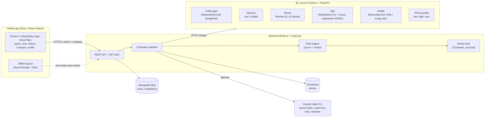
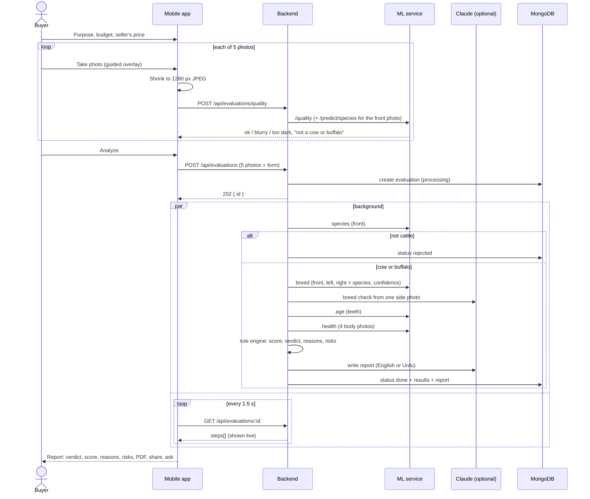

# MaweshiAI architecture

MaweshiAI helps a buyer at a Pakistani livestock market (mandi) decide whether to buy a cow or buffalo. The buyer picks a purpose (milk, breeding, Qurbani, meat, farm work), takes five guided photos (front, back, left side, right side, teeth), and gets a buy / be careful / don't buy report in English or Urdu within a few seconds.

Related documents: [API.md](API.md) (every endpoint), [PROMPTS.md](PROMPTS.md) (LLM prompts), [results/README.md](results/README.md) (model accuracy and timing).

## 1. Components



| Part | Technology | Main files |
|---|---|---|
| Mobile app | Expo SDK 54, React Native 0.81, expo-router, i18next (English / Urdu, right-to-left), expo-camera, expo-print | `mobile/app/*` (screens), `mobile/src/*` (components, theme, offline queue, PDF) |
| Backend | Node.js, Express 4, Mongoose 8, JWT, multer, Cloudinary SDK, Anthropic SDK | `backend/services/pipeline.js`, `rules.js`, `llm.js`, `breed.js` |
| ML service | Python 3.13, FastAPI, TensorFlow 2.21 / Keras 3, ONNX Runtime | `ml-service/main.py`, `ml-service/maweshi_ml/*`, `ml-service/models.yaml` |
| Database | MongoDB Atlas | `backend/models/User.js`, `Evaluation.js` |
| Photos | Cloudinary | `backend/services/storage.js` |
| LLM | Anthropic Claude Haiku 5.5, structured JSON output | `backend/services/llm.js` |

Every part degrades gracefully: without an LLM key the report comes from templates and the breed comes from the model alone; without Cloudinary the analysis still runs (photos just aren't stored); without internet the phone keeps the check and sends it later; if the ML service is down the check ends with a clear "service busy" message.

## 2. One evaluation, end to end



Measured time from Analyze to report: about 4.5 s on a laptop CPU without the LLM ([results](results/README.md#end-to-end-time)).

## 3. Decisions and why

| Decision | Reason | Evidence |
|---|---|---|
| A separate **cattle gate** (ImageNet classifier) decides "is this cattle?" | The species model only knows cow vs buffalo and scored goats, grass and cats as "cow" with > 95 % confidence | species-model threshold table in `results/README.md` |
| Gate also turns away **sheep** (ram + bighorn stronger than ox) | 42 % of sheep passed the gate before | Module 9, 25/60 → 8/60 |
| **Cow vs buffalo** from the gate's ox / water-buffalo split | 90 % on independent photos vs 70 % for the species model; the breed model's own buffalo score fails on buffalo breeds it doesn't know (Murrah) | `PROGRESS.md` Module 1 and 9 |
| **Breed** averages 4 views (centre crop, full frame, mirrors) and filters by species only when the species step is ≥ 75 % sure | +5 points from the views; always filtering cost 6 points | breed test split, 66.1 % (model alone) → 70.6 % |
| **LLM breed check** from a side photo | The breed model is weak on photos unlike its training set (about 20–25 %) and has no Pakistani breeds like Cholistani or Dhanni | `results/README.md` caveats |
| **Age** uses a 5-fold ensemble + flip/zoom; wide intervals are shown as "not certain – check teeth in person" | MAE 1.37 → 1.21 years; when not uncertain, MAE 0.74 | `results/age` |
| **Health** from the 4 body photos only | The disease model calls 42 % of healthy teeth close-ups foot-and-mouth | `results/health/metrics.json` |
| **Rules decide, the LLM explains** | The verdict must be reproducible and safe; the LLM only words it and may not contradict it | `backend/services/rules.js`, `PROMPTS.md` |
| Score = purpose fit 40 + age 25 + health 25 + model confidence 10, with safety caps | Disease → never "buy"; Qurbani animal under 2 years → don't buy; anything uncertain → at most "be careful" | `rules.js`, backend tests |
| Guests allowed; reports move to the account on sign-up | Buyers at a mandi won't register first | `authController.js` |
| Offline queue on the phone | Mandis often have weak signal | `mobile/src/offline/` |

## 4. Data stored

**User**: name, email, password hash (bcrypt), settings (language, alerts flag).

**Evaluation** (`backend/models/Evaluation.js`): owner (user id or guest id), status (`processing → done | failed | rejected`), purpose, budget, seller's price, experience, report language, photo URLs, per-photo quality, `steps[]` for the live progress screen, the raw output of every model (`results.*`, kept for the thesis and re-scoring), the verdict, score and its breakdown, the report text (with its source, LLM or template, and prompt version), a report id like `MW-261024-0418`, a random share key for the public QR page, and the last 20 chat messages.

Deleting an account deletes its evaluations and photos.

## 5. Security and privacy

- Passwords hashed with bcrypt; JWTs for accounts (7 days) and guests (30 days).
- Every evaluation route checks the owner; other people's reports return 404.
- Uploads limited to JPEG / PNG / WebP up to 8 MB.
- The public report page needs a random 24-character key (report ids alone are guessable), hides budget, price and owner, escapes all text and is not indexed.
- The ML service has no authentication and must stay on a private network.
- Secrets live only in `.env` files (git-ignored).

## 6. Repository layout

```text
mobile/       Expo app (screens in app/, shared code in src/)
backend/      Express API (controllers/, routes/, services/, models/, data/breeds.json, tests/)
ml-service/   FastAPI models (maweshi_ml/, model/, models.yaml, eval/, scripts/, tests/)
docs/         API, architecture, prompts, results/, screenshots/, design/, field test template
```

Tests: backend `npm test` (Jest, in-memory MongoDB), ML service `pytest`. Model evaluation: `ml-service/eval/evaluate.py`.
